<div align="center">

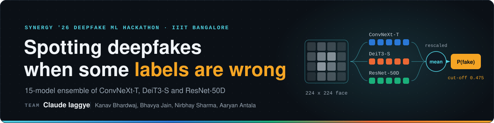

<br>
<br>

[](https://www.python.org/)
[](https://pytorch.org/)
[](#export-to-tensorflow)
[](https://github.com/huggingface/pytorch-image-models)
<br>
[](#rules-compliance)
[](#results)
[](#architecture)
[](#speed)

**[GitHub repository](https://github.com/Paradox-73/DeepFake_Hackathon)** &nbsp;|&nbsp; [Technical report](docs/technical_report.md) &nbsp;|&nbsp; [Report as PDF](docs/technical_report.pdf) &nbsp;|&nbsp; [Decision log](decisions.tsv)

</div>

This repository is the entry of team Claude laggye for the Synergy '26 Deepfake ML Hackathon at IIIT Bangalore. It classifies 224x224 face crops as real (0) or fake (1). The detector is an ensemble of 15 models: ConvNeXt-T, DeiT3-S, and ResNet-50D, with 5 seeds each, all trained on all 7,000 training images. Training shrinks a quarter of the images to between 10% and 35% of their size, so the detector holds up better on tiny, blurry faces. All backbones start from ImageNet weights. [`docs/technical_report.md`](docs/technical_report.md) explains the design and every experiment behind it.

**Contents:**
[Results at a glance](#results-at-a-glance) ·
[Overview](#overview) ·
[Quick start](#quick-start) ·
[Repository layout](#repository-layout) ·
[Rules compliance](#rules-compliance) ·
[Architecture](#architecture) ·
[Training pipeline](#training-pipeline) ·
[Results](#results) ·
[Wrong labels](#wrong-labels-in-the-training-data) ·
[Explainability](#explainability-and-ensemble-diversity) ·
[TensorFlow export](#export-to-tensorflow) ·
[Train from scratch](#train-from-scratch) ·
[Check the claims](#check-the-claims-in-the-report) ·
[Limitations](#limitations) ·
[Citations](#third-party-code-data-and-citations) ·
[Team](#team)

## Results at a glance

<p align="center">
  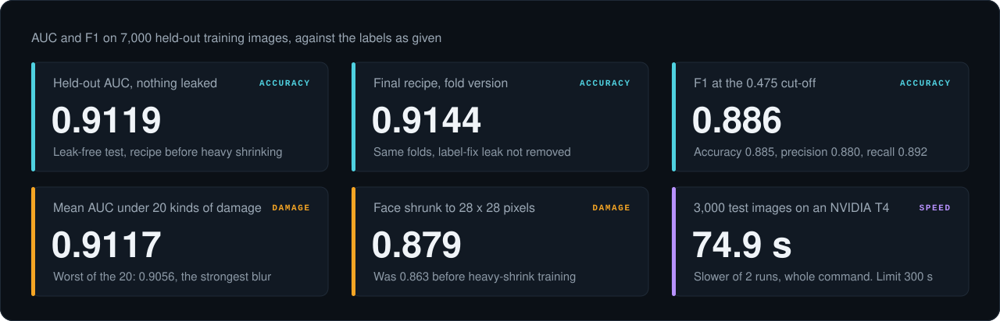
</p>

- **Score on images the models never saw.** AUC 0.9119 on all 7,000 training images, counted against the labels as given. It comes from 5-fold versions of the models, because a model trained on every image has none left to score. The scored images played no part in choosing which labels to fix.
- **Under damage.** The fold version of the final recipe scores AUC 0.9144. Mean AUC falls by only 0.0027 across 20 kinds of damage, and by 0.0043 across 21 more. The worst case is a face shrunk to 28x28 pixels: 0.879, where the previous recipe scored 0.863.
- **Speed.** 73 to 75 seconds for the 3,000 test images on an NVIDIA T4, the judges' GPU, counting Python start-up and model loading. That is a quarter of the 5-minute limit.
- **The biggest finding.** About 5% of the training labels are wrong on purpose. Fixing them for training helps, but by +0.0009 to +0.0019 once the test can't leak, not the +0.0052 we first measured.

## Overview

Each 224x224 face crop gets a label, real or fake, and a `confidence` that the image is fake. AUC is worth 50 points, and each 0.01 of AUC is worth 1 point. Speed is worth 20 points, and any run under 5 minutes on a T4 gets all 20.

The dataset has 7,000 training images (3,478 real, 3,522 fake) and 3,000 test images. We looked at the images before training anything. Three things stood out.

| Finding | What we did about it |
|---|---|
| Many images are damaged on purpose: noise, blur, pixelation, grey boxes, coloured squares, snow, inverted colours, and colour shifts, in real and fake images alike. | Training applies 18 damage types, plus a heavy shrink to between 10% and 35% of the size. Evaluation scores 41 kinds of damage. |
| The same photo often appears more than once. 921 images sit in near-duplicate groups, so a random split would put copies on both sides. | Near-duplicates are grouped first, then split into 5 folds, with each group kept in one fold (`configs/folds.csv`). |
| Some labels are wrong. The organisers' README says so: "occasional annotation ambiguity. This is intentional". | Copies of the same photo put the wrong-label rate at about 5%. 508 training labels are flipped for training only. See [Wrong labels](#wrong-labels-in-the-training-data). |

## Quick start

### 1. Get the code

```
git clone https://github.com/Paradox-73/DeepFake_Hackathon.git
cd DeepFake_Hackathon
```

The same code is in `source_code.zip` in the submission folder.

### 2. Get the weights

`model_weights.pt` is 732 MB. GitHub does not accept files that large, so the weights are not in this repository. Copy `model_weights.pt` from the hackathon submission folder on Google Drive into the repository root. The TensorFlow export, `tf_savedmodel.zip`, is in the same folder. To rebuild the weights yourself, see [Train from scratch](#train-from-scratch).

### 3. Reproduce the predictions

Use Python 3.10 and a CUDA GPU. On an NVIDIA T4 the whole run takes about 75 seconds. The run also works on a CPU, but it is much slower.

1. Install the dependencies.

   ```
   pip install -r requirements.txt
   ```

2. Run the detector on the test images.

   ```
   python inference_script.py --test_dir ./test/images/ --weights ./model_weights.pt --output predictions.csv
   ```

The script writes `image_id,label,confidence`, where `confidence` is the probability that the image is fake. It uses no random numbers. An unreadable image gets a confidence of 0.5 and a warning. The optional flags are `--batch_size` (default 64), `--workers` (default 0, images load in the main process), and `--threshold` (default: the 0.475 cut-off stored in `model_weights.pt`), which sets `label` = `confidence` >= threshold, as in the organisers' template.

### Files in the submission folder

| File | Contents |
|---|---|
| `predictions.csv` | `image_id,label,confidence` for all 3,000 test images |
| `model_weights.pt`, `inference_script.py`, `requirements.txt` | The PyTorch ensemble and the script that produced `predictions.csv` |
| `tf_savedmodel.zip`, `tf_inference.py` | The same ensemble as a TensorFlow SavedModel, and a script that runs it |
| `report.pdf` | Two-page brief: architecture, augmentations, and validation strategy |
| `technical_report.pdf` | Approach, architecture, experiments, results, and limitations |
| `source_code.zip` | This repository: training code, configs, scripts, and the decision log |
| `training_logs.zip` | Per-epoch loss, AUC, F1, and accuracy of all 15 fold runs |
| `gradcam.jpg`, `gradcam_families.jpg`, `training_curves.png` | Grad-CAM heatmaps (one model, then all three families) and training curves, also in the report |
| `video.mp4` | A walkthrough of the approach |

## Repository layout

| Path | Contents |
|---|---|
| [`inference_script.py`](inference_script.py) | Stand-alone inference. It imports nothing from this repository. |
| [`tf_inference.py`](tf_inference.py) | Stand-alone inference with the TensorFlow export. It needs no PyTorch. |
| `model_weights.pt` | The 15 all-data members with their score statistics and the decision threshold. In the submission folder only, not on GitHub. |
| [`train.py`](train.py), [`robust_eval.py`](robust_eval.py) | Train one fold and score it under perturbations. |
| [`dfd/`](dfd/) | Library code: data loading, augmentation, perturbations, models, and the training loop. |
| [`configs/exp.yaml`](configs/exp.yaml) | Settings shared by every experiment. |
| [`configs/folds.csv`](configs/folds.csv) | The 5-fold split. Near-duplicate photos always share a fold. |
| [`configs/relabel_flip85.csv`](configs/relabel_flip85.csv) | The 508 training labels that the first-round models overruled. |
| `configs/jobs_*.txt` | The exact overrides of every experiment in the report. |
| [`scripts/`](scripts/) | Folds, label audits, ensembling, evaluation, figures, and export. |
| [`decisions.tsv`](decisions.tsv) | A log of each decision with its evidence and result. |
| [`docs/technical_report.md`](docs/technical_report.md), [`docs/technical_report.pdf`](docs/technical_report.pdf) | The technical report. [`docs/report.pdf`](docs/report.pdf) is its two-page brief. |
| [`docs/figures/`](docs/figures/) | Every figure in this README and the report. |

## Rules compliance

| Rule | What this entry does |
|---|---|
| Pretrained architectures only | Three ImageNet-pretrained timm models: `convnext_tiny.fb_in22k_ft_in1k`, `deit3_small_patch16_224.fb_in22k_ft_in1k`, and `resnet50d.ra2_in1k`. The names are in `configs/exp.yaml` and `configs/jobs_*.txt`. |
| Fine-tune only on the official dataset | Every model fine-tunes on the 7,000 official training images and nothing else. No outside images, no extra fakes from other sources. |
| No deepfake-specific pretrained detectors | None used. Every weight file starts from plain ImageNet classification weights. |
| No CLIP or face-specific pretrained models | We took a strict reading of the rules. That ruled out CLIP, DINOv2 LVD-142M, JFT weights, and face-recognition models. |
| Test images never used for training | Nothing from the test set went into fitting, selection, thresholds, or scaling. Near-duplicates exist between training and test, and we did not use them. Section 8 of the report lists the read-only checks we ran on test images, such as format statistics. |
| Reproducible | The inference script uses no random numbers. A fresh Google Colab T4 reproduced `predictions.csv` with a largest confidence difference of 0.00011 and no label change. |

## Architecture

Each image goes through three kinds of network. They make different mistakes, and averaging cancels some of them.

| Family | Fold runs | timm model | Kind | Size | AUC alone, fold runs |
|---|---|---|---|---:|---:|
| ConvNeXt-T | `lrc25` | `convnext_tiny.fb_in22k_ft_in1k` | Modern CNN | 27.8 M | 0.9120 |
| DeiT3-S | `lrd25` | `deit3_small_patch16_224.fb_in22k_ft_in1k` | Transformer | 21.7 M | 0.9092 |
| ResNet-50D | `lrr25` | `resnet50d.ra2_in1k` | Older CNN | 23.5 M | 0.9126 |

<p align="center">
  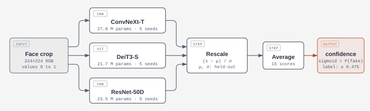
</p>

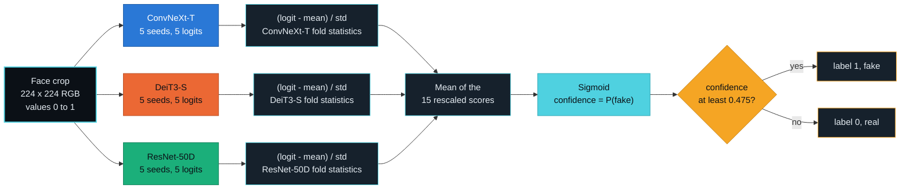

How one prediction works:

1. Each of the 15 models gives one raw score (a logit).
2. The score is rescaled with the mean and spread of its family's held-out scores, so every model counts equally. An all-data model has no held-out images, so these numbers come from the 5 fold models of the same family.
3. The 15 rescaled scores are averaged and turned into a probability by a sigmoid. That is the `confidence` column.
4. The `label` column uses a cut-off of 0.475, the best F1 on held-out images. It does not affect AUC.

Nothing here is computed from the test set. That is also why the ensemble avoids rank averaging, which needs test-set statistics.

## Training pipeline

<p align="center">
  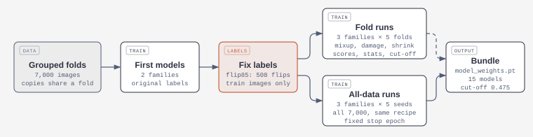
</p>

1. `scripts/make_folds.py` builds the 5-fold split into `configs/folds.csv`.
2. ConvNeXt-T and DeiT3-S train on the original labels. Each image gets scores only from models that never saw it.
3. `scripts/clean_labels.py` writes the 508 flips. They apply to training images only. Validation always keeps the original labels.
4. All three families train on the corrected labels with mixup and heavy shrinking, on 5 folds. These runs give the statistics and cut-off stored in the bundle.
5. All three families train again on all 7,000 images, with 5 seeds each and a fixed stop epoch: ConvNeXt-T 19, DeiT3-S 21, ResNet-50D 25. Each is the epoch that was best when pooled over the family's 5 folds.
6. `scripts/build_bundle.py` packs the 15 all-data models into `model_weights.pt`, with score statistics and the cut-off from step 4.

Fold runs give every score in the report and the statistics and cut-off in the bundle (the dashed arrow above). All-data runs give the weights.

### Hyperparameters

The settings below are shared unless a family is named. `configs/jobs_*.txt` lists the overrides of every experiment.

| Setting | Value | Why |
|---|---|---|
| Optimiser | AdamW, learning rate 2e-4, weight decay 0.05 | 1e-4 lost on fold 0 |
| Schedule | 25 epochs, 1 warmup epoch, cosine decay | 40 epochs added nothing |
| Batch | 64, fp16, gradient clip 1.0 | Fits the shared GPU |
| Weights kept | Moving average with decay 0.998 | AUC stays flat to the last epoch |
| Loss | Binary cross-entropy, label smoothing 0.05 | Section 4 of the report |
| Mixup | Beta(0.4, 0.4) | Section 4 of the report |
| Dropout, drop path | ConvNeXt-T 0.3, 0.3. DeiT3-S 0.1, 0.1. ResNet-50D 0.3, 0.1 | All three tested in section 4 |
| Basic augmentation | Flip 0.5, crop 0.5, colour jitter 0.5, JPEG 0.4, blur 0.25, noise 0.25, rescale 0.25 | Starting point |
| Damage augmentation | 18 types, p=0.6, up to 2 per image | Section 4 of the report |
| Heavy shrink | 25% of images, to 10% to 35% of their size, then back to 224 px | Section 4 of the report |
| Stop point | Fold runs: best validation AUC. All-data runs: fixed epoch 19, 21, or 25 | Section 4 of the report |

Training ran on an NVIDIA RTX A6000 shared with another job, with Python 3.10.12, PyTorch 2.5.1, and timm 1.0.30. An epoch took 9 to 25 seconds, and a full run took 5 to 10 minutes. AUC levels off by about epoch 15.

<p align="center">
  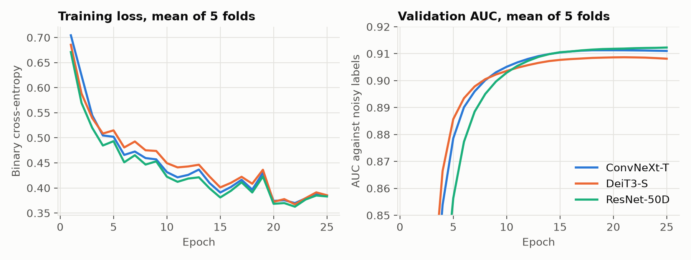
  <br>
  <sub>Mean training loss and validation AUC over 5 folds. Loss stays above zero because mixup targets are never fully certain.</sub>
</p>

## Results

### Accuracy

All AUC values below are on the 7,000 training images, each scored by fold models that never trained on it, against the labels as given.

| Ensemble, 5 folds | AUC |
|---|---:|
| **Leak removed: label fix redone without the scored fold, recipe before heavy shrinking (headline)** | **0.9119** |
| Final recipe, fold version, label-fix leak not removed | 0.9144 |
| Previous recipe, fresh run | 0.9137 |
| Previous recipe, runs picked as the best of many | 0.9158 |

The 0.9119 is the most honest score, so it is the headline. The 0.9158 came from runs picked as the best of many, which adds about 0.002 of luck. The submitted all-data models have more data behind them, so we expect a small gain on top, but we can't measure it. Single models range from 0.894 to 0.927 between folds, so the luck of the split moves AUC more than any method in the report.

The last change, heavy shrinking, was tested against a fresh run of the previous recipe:

| Ensemble, 5 folds | AUC | Mean over 20 kinds of damage | Worst of those 20 | Shrunk to 1/8 |
|---|---:|---:|---:|---:|
| Previous recipe, fresh run | 0.9137 | 0.9112 | 0.9035 | 0.863 |
| Shrink 10% of training images | 0.9144 | 0.9120 | 0.9056 | 0.874 |
| **Shrink 25% of training images (final)** | **0.9144** | **0.9117** | **0.9056** | **0.879** |
| Previous recipe, picked runs | 0.9158 | 0.9129 | 0.9059 | 0.866 |

The 25% version scores +0.0007 against the fresh run (standard error 0.0007), so we count it as no loss rather than a gain. It beats the fresh run on 30 of the 41 kinds of damage and lifts the eighth-size shrink by 0.016.

### Labels at the cut-off

The 0.475 cut-off is the best F1 on held-out scores, over a grid from 0.05 to 0.95. At that cut-off, the fold version of the final recipe scores F1 0.886 and accuracy 0.885, with precision 0.880 and recall 0.892. The cut-off only sets the `label` column, so it has no effect on AUC.

<p align="center">
  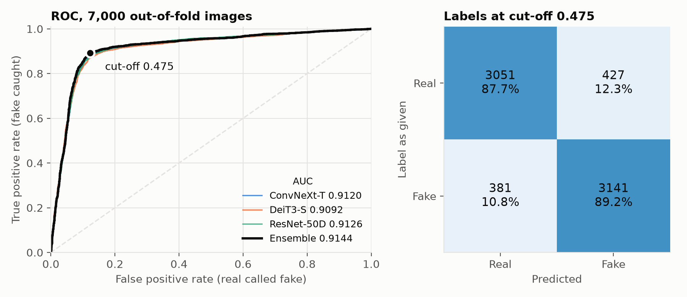
  <br>
  <sub>ROC curve and confusion matrix of the final recipe's fold version. The sharp bend near a 10% false positive rate, followed by a long flat tail, fits the wrong-label finding: about one image in ten is scored confidently against its given label.</sub>
</p>

If the test labels are clean, the real AUC should be higher. A training flip rate of 3%, 5%, or 8% would put the true AUC at about 0.94, 0.96, or 0.99. These are estimates, and we don't know how clean the test labels are.

### Robustness to damage

`scripts/ens_eval.py` applies 20 kinds of damage to every image and scores it with fold models that never trained on it. This test uses the fold version of the final recipe. Mean AUC drops by only 0.0027. The ensemble beats every single family on both the mean and the worst case.

<p align="center">
  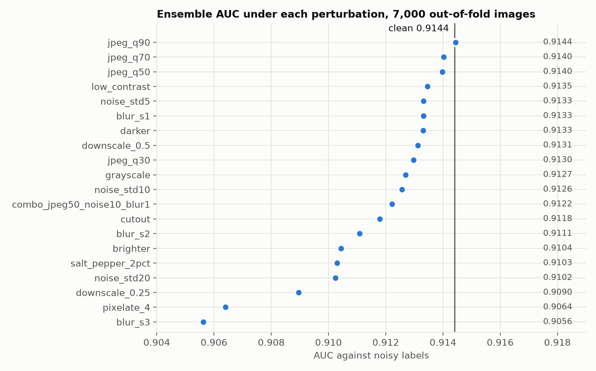
  <br>
  <sub>Ensemble AUC under each kind of damage. The line marks undamaged AUC.</sub>
</p>

A further 21 kinds of damage (`--extra`) cover colour shifts, swapped colour channels, inverted colours, rotations of 5 to 15 degrees, crops, JPEG quality 20 and 10, gamma, sharpening, posterising, motion blur, speckle, and a shrink to one eighth of the size. Twenty of the 21 cost at most 0.0073. The exception is the one-eighth shrink, which leaves a 28x28 pixel face. It scores 0.879, up from 0.863 before training with heavy shrinking. Too little detail survives at that size to do much better.

<p align="center">
  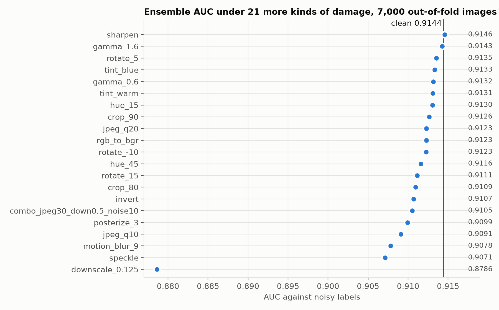
  <br>
  <sub>Ensemble AUC under 21 more kinds of damage. The line marks undamaged AUC.</sub>
</p>

**Stable confidence.** Across all 41 kinds of damage, the median shift in mean confidence is 0.003. The largest is an 80% centre crop, which moves it 0.048 toward real. Heavy shrinking cut the shift for the eighth-size shrink from 0.040 to 0.009. Scored as one pool, all 42 versions of the 7,000 images give AUC 0.9109, against a mean of 0.9110 when each version is scored on its own. So damaged images keep their place on the same scale as clean ones.

### Speed

Run time for the 3,000 test images. "Whole command" counts Python start-up, model loading, and writing the CSV.

| GPU | Run time | Peak GPU memory |
|---|---:|---:|
| NVIDIA T4, Google Colab, fresh install from `requirements.txt`, final build | 73.1 s and 74.9 s whole command (67.0 s and 69.7 s inside the script) | not recorded |
| NVIDIA T4, Google Colab, earlier build | 72.5 s and 71.4 s whole command (66.9 s and 66.0 s inside the script) | not recorded |
| RTX 3050 Laptop, 4 GB, final build | 81 s and 81 s inside the script | 2.6 GB |
| RTX 3050 Laptop, 4 GB, earlier build, other jobs using the CPU | 90 s, 96 s, 119 s, 165 s | 2.6 GB |
| RTX A6000, final build | 25 s inside the script (30 s for the earlier build) | 2.6 GB |

On the T4, the whole command finishes in about a quarter of the 5-minute limit. `model_weights.pt` is 732 MB, well under the 5 GB limit.

<details>
<summary><b>Experiments that did not make the final model</b></summary>

<br>

**Backbones (fold 0).** Bigger didn't help.

| Model | AUC |
|---|---:|
| ConvNeXt-T | 0.9160 |
| DeiT3-S | 0.9141 |
| ConvNeXt-T at 320 px | 0.9135 |
| ConvNeXt-S | 0.9128 |
| Swin-T | 0.9125 |
| ViT-S | 0.9113 |
| EfficientNetV2-S | 0.9111 |
| Xception | 0.9042 |
| EfficientNet-B4 | 0.9012 |

**Four fancier ideas, paired against the final recipe on 5 folds.** All four lost.

| Method | AUC gain | Robust gain |
|---|---:|---:|
| Sharpness-aware minimisation | -0.0002 | +0.0008 |
| Generalised cross-entropy | -0.0036 | -0.0043 |
| Soft labels | -0.0020 | -0.0019 |
| A second flip round from the better models | -0.0014 | -0.0016 |

**Self-blended fakes.** On fold 0, replacing 30% of fakes with self-blended fakes scored 0.9079, replacing 50% scored 0.9000, and training on self-blends only scored 0.5911. It lost at every mix. The code is still in `dfd/augment.py`, switched off, so anyone can repeat this.

**Test-time tricks and stacking (against 0.9158).** Mirror averaging scored 0.9155, learned family weights 0.9151, gradient-boosted stacking 0.9128. A plain mean has nothing to overfit.

Section 4 of the [technical report](docs/technical_report.md) has every experiment, including newer backbones (FocalNet, Hiera, MambaOut, NFNet-L0) tried as a fourth family.

</details>

## Wrong labels in the training data

Small models, big models, and higher resolution all stopped at about 0.91 AUC. Models were also confidently wrong in both directions, about equally often. Three tests showed why.

1. **Copies of the same photo, no model involved.** A photo can't be both real and fake. Comparing near-duplicates at full resolution, by fine skin texture, gave 145 pairs that are copies of one photo. In 14 of them, one copy says real and the other says fake. If each label flips independently at rate e, a pair disagrees at rate 2e(1-e), so e is about 5%, with a 95% range of about 3% to 8.5%.
2. **Model agreement.** In 12 of the 14 pairs, the models put both copies on the same side, as expected from one photo with one wrong label.
3. **Damage.** Specific kinds of damage hurt: AUC is 0.923 on images with no obvious damage, 0.880 on blue-tinted images, 0.887 on very dark ones, and 0.901 on noisy ones. So the 7.7% of labels that the models overrule are a mix of wrong labels and hard images.

<p align="center">
  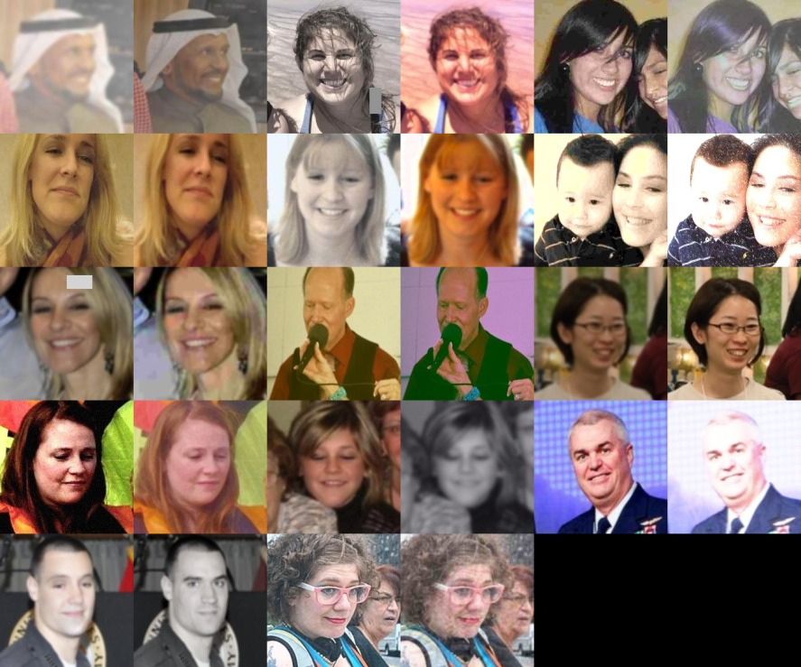
  <br>
  <sub>All 14 copy pairs with opposite labels. In each pair, the left image is labelled real and the right image is labelled fake.</sub>
</p>

Wrong labels cap the score you can measure. If a share e of validation labels is flipped, a model with true AUC A measures e + (1 - 2e)A. Even a perfect model measures only 1 - e.

**The fix.** "flip85" flips a training label when the models, scoring an image they never trained on, disagree with it by 0.85 or more. That changes 508 labels: 256 real and 252 fake. The first measurement leaked, because the models that chose the flips had trained on the images later scored. Redoing the whole label fix with each fold held out gives the real gain:

| Family | Gain as first measured | Gain with nothing leaked | Robust gain with nothing leaked |
|---|---:|---:|---:|
| DeiT3-S | +0.0052 | +0.0009 | +0.0014 |
| ConvNeXt-T | +0.0044 | +0.0019 | +0.0023 |

## Explainability and ensemble diversity

**Grad-CAM.** The heat from one ConvNeXt-T model sits mostly on the inner face and skips the background and the grey boxes. That is the region a face swap changes. It shows where the model looks, not why it decided.

<p align="center">
  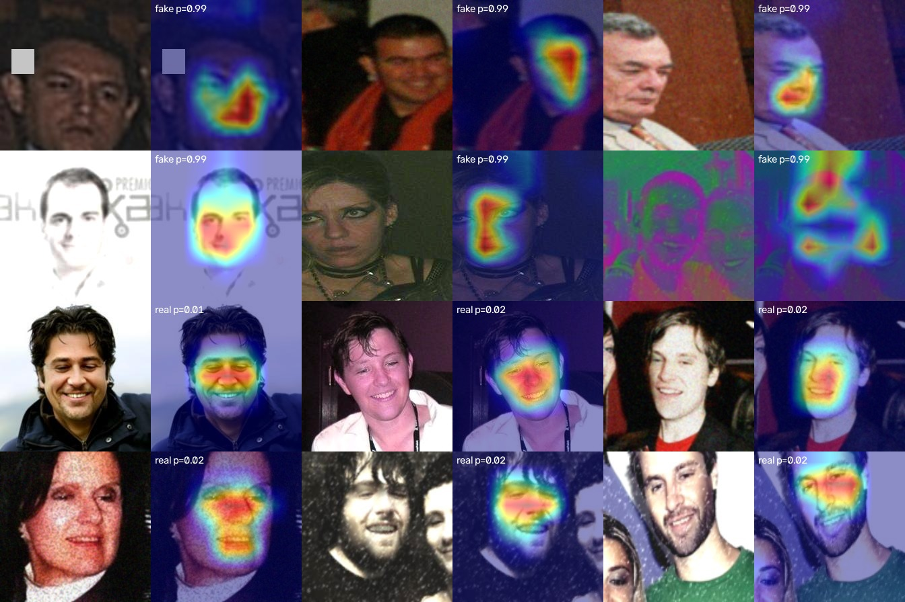
  <br>
  <sub>Grad-CAM on validation images. Top two rows: confident fakes, showing evidence for fake. Bottom two rows: confident reals, showing evidence for real.</sub>
</p>

Across families, ConvNeXt-T and ResNet-50D focus on the inner face. DeiT3-S spreads over the whole image, with a few hot spots at the edges, which vision transformers are known to produce (Darcet et al., 2024). The families look at different evidence.

<p align="center">
  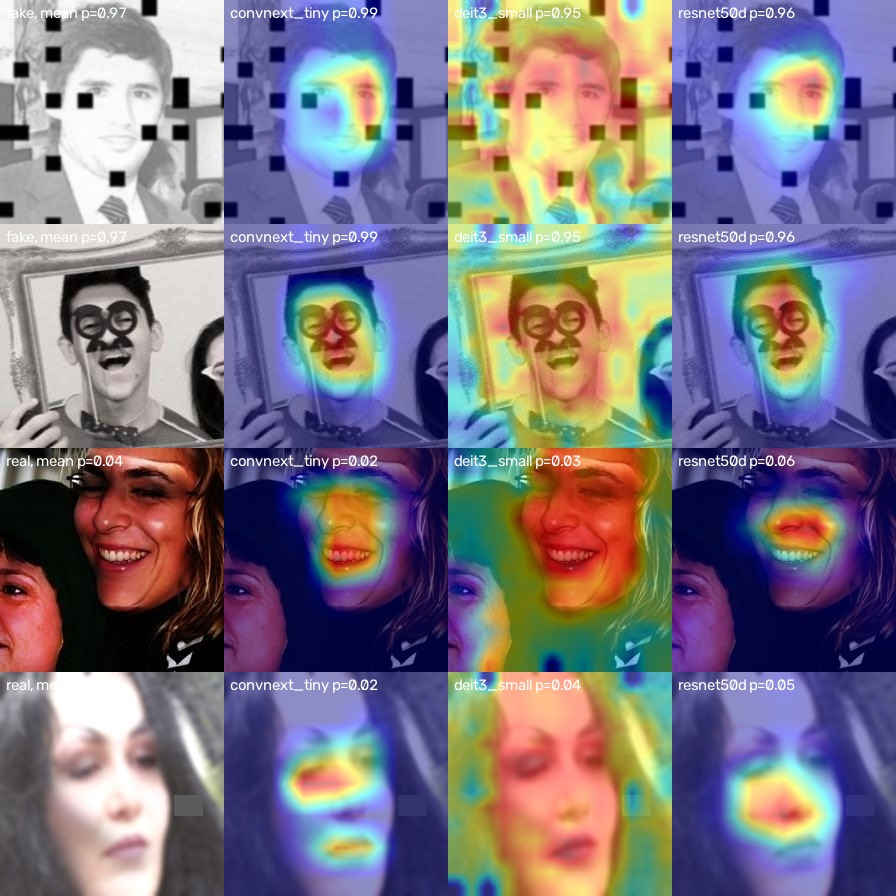
  <br>
  <sub>Columns: input, ConvNeXt-T, DeiT3-S, ResNet-50D. Top two rows: fakes, showing evidence for fake. Bottom two rows: reals, showing evidence for real. For DeiT3-S the map is taken at the input of its last attention block, because only the class token feeds its output.</sub>
</p>

**Diverse ensemble.** The families make different mistakes. Their held-out scores have rank correlations of only 0.901 to 0.941, and ResNet-50D agrees least with the other two (0.901 with DeiT3-S, 0.910 with ConvNeXt-T). At the 0.475 cut-off, 312 images are wrong for exactly one family, and the ensemble gets 91.3% of them right. Another 664 images are wrong for all three families, which fits the mix of wrong labels and hard images above.

Ensemble ablation, out-of-fold on all 7,000 images, with the runs from before heavy shrinking:

| Ensemble | AUC |
|---|---:|
| ConvNeXt-T and DeiT3-S, before label work | 0.9103 |
| ConvNeXt-T and DeiT3-S | 0.9145 |
| ConvNeXt-T and ResNet-50D | 0.9148 |
| DeiT3-S and ResNet-50D | 0.9158 |
| **All three families** | **0.9158** |
| All three and Swin-T | 0.9155 |

## Export to TensorFlow

`scripts/export_tf_ensemble.py` writes the whole ensemble as one TensorFlow SavedModel. It takes two steps because PyTorch and TensorFlow live in separate environments.

1. In the PyTorch environment, run `python scripts/export_tf_ensemble.py dump --weights model_weights.pt --images <any image folder> --out tf_dump.npz`.
2. In an environment with `tensorflow-cpu` and `numpy`, run `python scripts/export_tf_ensemble.py build --dump tf_dump.npz --out tf_savedmodel`.

Step 2 compares every member with PyTorch on 16 real images and fails if they differ. The model takes RGB images of 224x224 with values from 0 to 1, and it returns `confidence`.

To score a folder with the export, install `tensorflow-cpu` (or `tensorflow`), `numpy`, and `opencv-python-headless`, then run:

```
python tf_inference.py --test_dir ./test/images/ --weights ./tf_savedmodel.zip --output predictions_tf.csv
```

It writes the same columns as `inference_script.py`, and its confidence matches `predictions.csv` to about 0.0001. It is slow on a CPU: 32 images took 4.5 minutes on 2 CPU threads, including unzipping. A GPU build of TensorFlow is much faster, or pass a folder with a few images to check the export.

onnx2tf 1.27.10 failed on ConvNeXt-T and DeiT3-S, so the script rewrites all three networks in plain TensorFlow operations and copies the trained weights across. On 16 real images, the largest confidence difference from PyTorch is 0.00001, and the largest difference in any member's score is 0.0004. The export is 712 MB. On 64 test images on a T4 GPU with TensorFlow 2.21, the largest difference from `predictions.csv` is 0.0001, with no label change.

## Train from scratch

One run takes 5 to 10 minutes on an RTX A6000, so the 40 runs below take about 3 hours at two runs at a time. Put the dataset in `data/dataset/hackathon_dataset/` and run these commands from a Linux shell.

```
python -m venv .venv && .venv/bin/pip install -r requirements.txt
bash scripts/reproduce.sh
```

`scripts/reproduce.sh` runs these steps in order:

1. It trains ConvNeXt-T and DeiT3-S on 5 folds with the original labels.
2. It builds `configs/relabel_flip85.csv` from their out-of-fold predictions.
3. It trains the three final families on 5 folds with the corrected labels, mixup, and heavy shrinking (`configs/jobs_final_lr25.txt`). These runs give the statistics and cut-off in the bundle, and the final recipe's scores in the report.
4. It trains the same three families on all 7,000 images, with 5 seeds each and a fixed stop epoch (`configs/jobs_e22.txt`).
5. It packs the all-data models into `runs/final/model_weights.pt`, using score statistics from the fold runs, and writes `runs/final/predictions.csv`.

`configs/folds.csv` is already in the repository. To rebuild it, run `python scripts/make_folds.py`. Seeds are fixed, but a retrained model is not identical bit for bit across GPUs or library versions.

## Check the claims in the report

- Out-of-fold ensemble AUC and robustness table: `python scripts/ens_eval.py --families lrc25 lrd25 lrr25 --out runs/final/ens_eval`. Add `--extra` and `--out runs/final/ens_eval_extra` for the 21 further kinds of damage.
- Heavy shrinking against a fresh rerun of the previous recipe: train `configs/jobs_e10.txt` and `configs/jobs_e10c.txt` (the `s1c`, `s1d`, `s1r` runs), score both with `python scripts/ens_eval.py --families s1c s1d s1r lrc25 lrd25 lrr25 --out runs/e21/eval5_default` (and again with `--extra --out runs/e21/eval5_extra`), then run `python scripts/compare_mixes.py runs/e21/eval5_default_scores.npz runs/e21/eval5_extra_scores.npz --mix fresh=s1c,s1d,s1r new25=lrc25,lrd25,lrr25`.
- Wrong labels in the training set: `python scripts/label_evidence.py --families cfm dflipmix sfm`, then `python scripts/exact_copies.py`. These runs, from the recipe before heavy shrinking, are not part of `reproduce.sh`. Train them first with `bash scripts/run_jobs.sh configs/jobs_final.txt 2 configs/exp.yaml` and `bash scripts/run_jobs.sh configs/jobs_e6.txt 2 configs/exp.yaml`.
- Same results in a fresh Python 3.10 environment: `bash scripts/clean_env_check.sh`
- Grad-CAM figures: `python scripts/gradcam.py --run runs/lrc25_f0 --n 12 --out docs/figures/gradcam.jpg`, and for all three families `python scripts/gradcam.py --run runs/lrc25_f0 runs/lrd25_f0 runs/lrr25_f0 --n 4 --out docs/figures/gradcam_families.jpg`
- Report charts: `python scripts/make_figures.py`

What we checked for reproducibility:

| Check | Result |
|---|---|
| Same machine, twice | Byte-identical `predictions.csv`, on the server and again on the laptop |
| Laptop against server, different GPUs and PyTorch versions | Largest confidence difference 0.00009, no label changed |
| Clean Python 3.10 environment built only from `requirements.txt` | Ran in 26 seconds. Largest difference 0.00005, no label changed |
| Fresh Google Colab T4 with `requirements.txt` | Largest confidence difference 0.00011, no label change. Colab kept its own OpenCV 4.14 rather than the pinned 5.0, so the result also holds across OpenCV versions |
| Training, same seed and same data on one GPU | Byte-identical validation predictions |

## Limitations

- **Noisy validation.** Every choice was made against noisy labels. Small differences between methods remain uncertain, even on 5 folds.
- **Slightly flattering numbers.** Fold runs keep their best epoch by validation AUC. In 12 of 15 models that is under 0.002 above the last epoch, and the largest gap is 0.0048. Numbers from picked runs read about 0.002 high.
- **The submitted models have no score of their own.** All 7,000 images trained them, so nothing can test them directly. Every AUC here comes from the fold version of the same recipe.
- **The label estimate has assumptions.** The 3% to 8.5% range assumes each copy flips independently. One of the 14 pairs may not be a true copy.
- **Unknown test variants.** The hidden test variants are not visible, and the 41 kinds of damage are a guess at them.
- **Retraining is close, not identical.** Seeds are fixed, but retrained models differ slightly across GPUs and library versions.

## Third-party code, data and citations

The detector trains only on the official dataset. Pretrained weights are ImageNet weights from [timm](https://github.com/huggingface/pytorch-image-models). Other libraries are PyTorch, TensorFlow, OpenCV, NumPy, scikit-learn, and pandas. Training and figure scripts also use PyYAML, tqdm, psutil, Pillow, and matplotlib (`requirements.txt`).

- Liu et al., A ConvNet for the 2020s, CVPR 2022.
- Touvron et al., Revisiting ViT: DeiT III, ECCV 2022.
- He et al., Bag of Tricks for Image Classification, CVPR 2019.
- Zhang et al., mixup: Beyond Empirical Risk Minimization, ICLR 2018.
- Northcutt et al., Confident Learning, JAIR 2021. https://arxiv.org/abs/1911.00068
- Shiohara and Yamasaki, Detecting Deepfakes with Self-Blended Images, CVPR 2022. https://arxiv.org/abs/2204.08376
- Foret et al., Sharpness-Aware Minimization, ICLR 2021. https://arxiv.org/abs/2010.01412
- Zhang and Sabuncu, Generalized Cross Entropy Loss, NeurIPS 2018.
- Selvaraju et al., Grad-CAM, ICCV 2017. https://arxiv.org/abs/1610.02391
- Yan et al., DeepfakeBench, NeurIPS 2023. https://arxiv.org/abs/2307.01426
- Darcet et al., Vision Transformers Need Registers, ICLR 2024. https://arxiv.org/abs/2309.16588

## Team

Team **Claude laggye**, Synergy '26 Deepfake ML Hackathon, IIIT Bangalore.

- Kanav Bhardwaj
- Bhavya Jain
- Nirbhay Sharma
- Aaryan Antala

Repository: [github.com/Paradox-73/DeepFake_Hackathon](https://github.com/Paradox-73/DeepFake_Hackathon)
