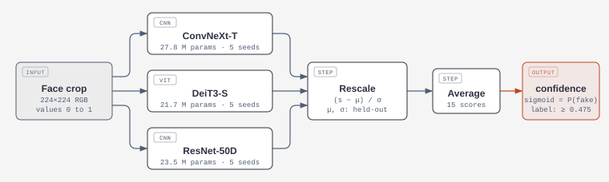
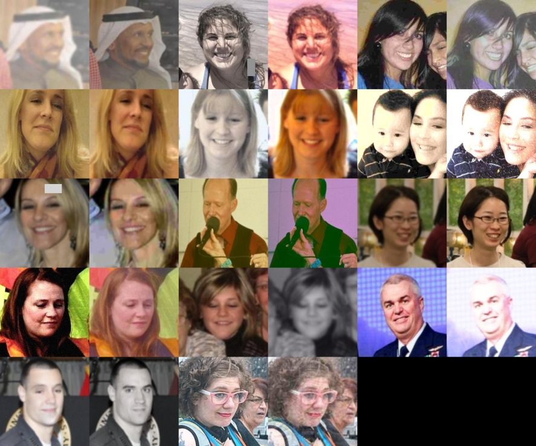
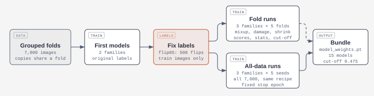
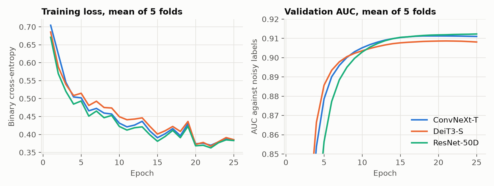
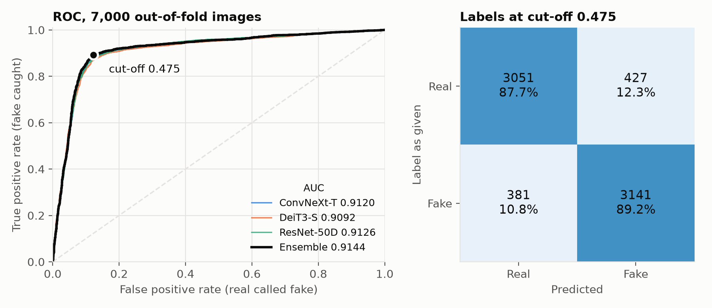
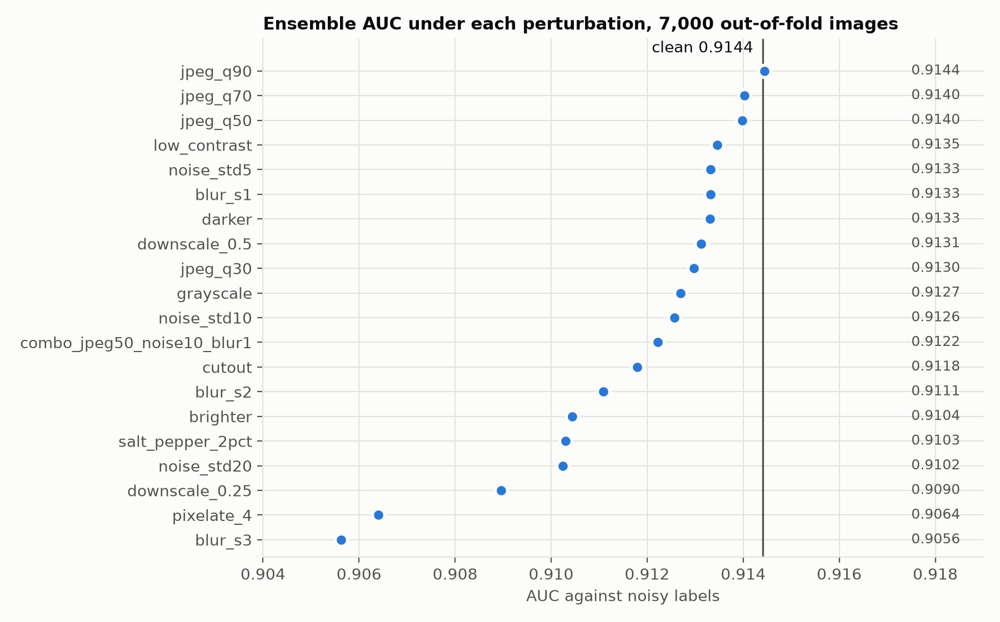
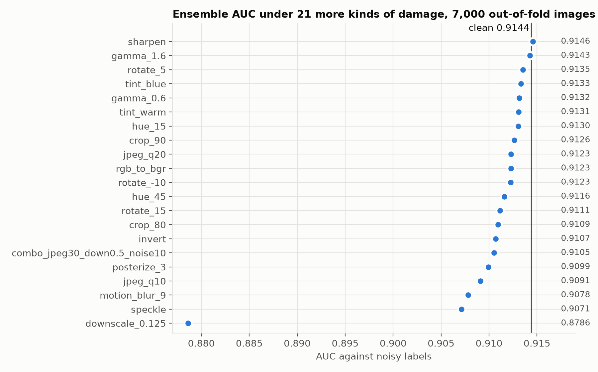
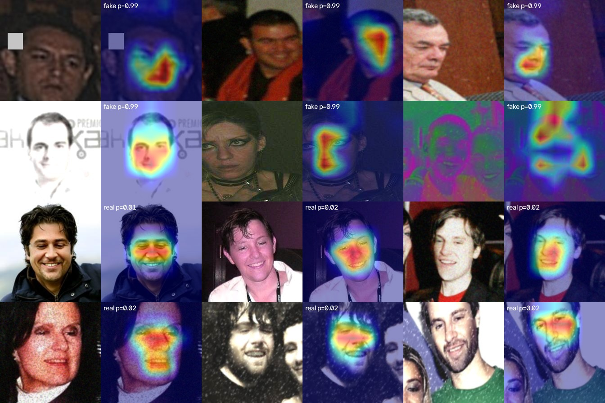
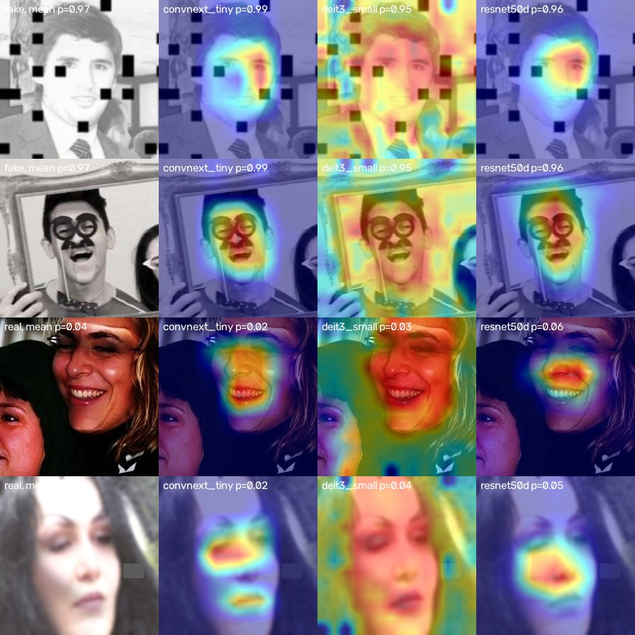

# Spotting deepfakes when some of the labels are wrong

Synergy '26 Deepfake ML Hackathon, IIIT Bangalore. Team Claude laggye: Kanav Bhardwaj, Bhavya Jain, Nirbhay Sharma, Aaryan Antala. Code: [github.com/Paradox-73/DeepFake_Hackathon](https://github.com/Paradox-73/DeepFake_Hackathon).

## The short version

- **What we built.** 15 models from 3 families, averaged: 5 seeds of each family, each trained on all 7,000 images. All start from ImageNet weights and train only on the official dataset. Training also shrinks a quarter of the images to between 10% and 35% of their size, which lifted our one weak spot from 0.863 to 0.879 AUC (section 4).
- **Score on images the models never saw.** AUC 0.9119 on all 7,000 training images, counted against the labels as given. We measured it on 5-fold versions of the models, because a model trained on every image has none left to score, and the scored images played no part in choosing which labels to fix. Without that protection, a fresh run reads 0.9137, and section 4 explains the gap. Our last change, heavy shrinking, scored +0.0007 on top of that with a standard error of 0.0007, so we count it as no loss rather than a gain.
- **Under damage.** On the fold version of the final recipe (AUC 0.9144), mean AUC falls by only 0.0027 across 20 kinds of damage, and by 0.0043 across 21 more. The worst case is a face shrunk to 28x28 pixels: 0.879, where the previous recipe scored 0.863.
- **Speed.** 73 to 75 seconds for the 3,000 test images on an NVIDIA T4, the judges' GPU, counting Python start-up and model loading. That is a quarter of the 5-minute limit.
- **The biggest finding.** Some training labels are wrong on purpose, about 5% of them. Fixing them for training helps, but by +0.0009 to +0.0019 once the test can't leak, not the +0.0052 we first measured.

## 1. Problem statement and approach

You get 224x224 face crops and label each one real or fake. AUC is worth 50 points, and each 0.01 of AUC is worth 1 point. Speed is worth 20, but it's a step: anything under 5 minutes on a T4 gets all 20. So we kept adding models until the 5-minute limit started to matter, and not a moment before.

We looked at the images before training anything. The dataset has 7,000 training images (3,478 real, 3,522 fake) and 3,000 test images. Three things stood out.

1. **Many images are damaged on purpose.** Noise, blur, pixelation, grey boxes, coloured squares, snow, inverted colours, and colour shifts all appear, in real and fake images alike. The hidden test variants will probably look similar, so we train on the same damage.
2. **The same photo often appears more than once.** 921 images sit in near-duplicate groups. A random split would put copies on both sides and make validation look better than it is. We grouped near-duplicates first, then split into 5 folds, keeping each group together. We set the match threshold loose on purpose: a false match costs nothing, but a missed one leaks a photo.
3. **Some labels are wrong.** The organisers' README says so: "occasional annotation ambiguity. This is intentional". Section 3 measures how many.

The rules ban deepfake-specific pretrained models and outside data. We took a strict reading: ImageNet weights from timm only. That ruled out CLIP, DINOv2 LVD-142M, JFT weights, and face-recognition models.

## 2. Model architecture

Each image goes through three kinds of network. They make different mistakes, and averaging cancels some of them.

| Family | Fold runs | timm model | Kind | Size | AUC alone, fold runs |
|---|---|---|---|---:|---:|
| ConvNeXt-T | `lrc25` | `convnext_tiny.fb_in22k_ft_in1k` | Modern CNN | 27.8 M | 0.9120 |
| DeiT3-S | `lrd25` | `deit3_small_patch16_224.fb_in22k_ft_in1k` | Transformer | 21.7 M | 0.9092 |
| ResNet-50D | `lrr25` | `resnet50d.ra2_in1k` | Older CNN | 23.5 M | 0.9126 |

How one prediction works:

1. Each of the 15 models gives one raw score (a logit).
2. We rescale that score using the mean and spread of its family's held-out scores, so every model counts equally. An all-data model has no held-out images, so these numbers come from the 5 fold models of the same family.
3. We average the 15 scores and turn the result into a probability. That's the `confidence` column.
4. The `label` column uses a cut-off of 0.475, the best F1 on held-out images. It doesn't affect AUC.

Nothing here is computed from the test set. That's also why we avoided rank averaging, which needs test-set statistics.

*Figure 1. How one prediction is made. μ and σ are the mean and spread of each family's held-out scores, so every model counts equally in the average.*

## 3. The data challenge: how we know labels are wrong, and how many

The first sign was odd. Small models, big models, and higher resolution all stopped at about 0.91. Models were also confidently wrong in both directions, about equally often. That could mean wrong labels or hard images, so we tested it.

**Test 1: copies of the same photo, no model involved.** A photo can't be both real and fake. We compared near-duplicates at full resolution, looking at fine skin texture, because a face swap keeps the pose but changes the texture. That gave 145 pairs that are copies of one photo. In 14 of them, one copy says real and the other says fake. Figure 2 shows all 14.

If each label flips independently at rate e, a pair disagrees at rate 2e(1-e). So 14 of 145 means e is about 5%, and the 95% range is about 3% to 8.5%.

Our first version of this test compared small thumbnails. It said 9.5%, but thumbnails can't tell a copy from a swap, so we threw it out.

*Figure 2. All 14 copy pairs with opposite labels. In each pair, the left image is labelled real and the right image is labelled fake.*

**Test 2: do the models agree with each other about these pairs?** In 12 of the 14 pairs, the models put both copies on the same side, as you'd expect from one photo with one wrong label.

**Test 3: is it just damage?** Partly. Sorting images by sharpness, speckle, brightness, or file size barely moves the disagreement rate: it stays between 6.9% and 8.3%. But specific kinds of damage do hurt. AUC is 0.923 on images with no obvious damage, 0.880 on blue-tinted images, 0.887 on very dark ones, and 0.901 on noisy ones. So the 7.7% of labels that the models overrule are a mix of wrong labels and hard images.

Why this matters: wrong labels cap the score you can measure. If a share e of validation labels is flipped, a model with true AUC A measures e + (1 - 2e)A. Even a perfect model measures only 1 - e. So every validation number in this report understates the real model.

## 4. Hyperparameter selection and ablations: what we tried, and what the numbers said

**How we decided.** One fold of 1,400 images has an AUC error of about 0.008, bigger than most effects here. So a single fold only filters ideas. To keep a change, it had to win on the same folds as the thing it replaced. This saved us twice: a fold-0 score of 0.916 fell to 0.908 on all folds, and a 3-fold gain of +0.0077 fell to +0.0052 on 5.

"Robust" below means mean AUC over 20 kinds of damage.

**Damage and regularisation (ConvNeXt-T, fold 0).**

| Change | AUC | Robust | Verdict |
|---|---:|---:|---|
| Standard augmentation only | 0.9140 | 0.9089 | Starting point |
| Add 18 damage types, p=0.6, up to 2 per image | 0.9162 | 0.9136 | Kept. Worst case rose from 0.885 to 0.904 |
| Add drop path 0.3 and dropout 0.3 | 0.9160 | 0.9137 | Kept. Last-epoch AUC rose from 0.9000 to 0.9138 |
| Learning rate 1e-4 instead of 2e-4 | 0.9147 | 0.9112 | Dropped |
| Label smoothing 0.1 instead of 0.05 | 0.9155 | 0.9125 | Dropped |
| Replace 30% of fakes with self-blended fakes | 0.9079 | 0.9066 | Dropped |
| Replace 50% | 0.9000 | 0.8988 | Dropped |
| Train on self-blends only | 0.5911 | 0.5801 | Dropped. These models can't find the real fakes |

We expected self-blending to win, because it's strong in the published work. It lost at every mix. The code is still in `dfd/augment.py`, switched off, so anyone can repeat this.

**Backbones (fold 0).** Bigger didn't help.

| Model | AUC |
|---|---:|
| ConvNeXt-T | 0.9160 |
| DeiT3-S | 0.9141 |
| ConvNeXt-T at 320 px | 0.9135 |
| ConvNeXt-S | 0.9128 |
| Swin-T | 0.9125 |
| ViT-S | 0.9113 |
| EfficientNetV2-S | 0.9111 |
| Xception | 0.9042 |
| EfficientNet-B4 | 0.9012 |

**Handling wrong labels (DeiT3-S, gain over the base model).** "flip85" flips a training label when the models, scoring an image they never trained on, disagree with it by 0.85 or more. That changes 508 labels: 256 real and 252 fake.

| Method | Folds | AUC gain | Verdict |
|---|---:|---:|---|
| flip85 | 3 | +0.0035 | Used |
| Drop those images instead | 3 | +0.0033 | Dropped |
| Flip at 0.70 | 3 | +0.0035 | Dropped, no better and changes more labels |
| Mixup 0.4 alone | 3 | +0.0015 | Used |
| **flip85 and mixup 0.4** | **5** | **+0.0052** | **Final recipe.** Robust +0.0057, up on all 5 folds |
| flip85 with 40 epochs | 3 | +0.0038 | Dropped, slower and no better |

Around that recipe we tried mixup 0.2 and 1.0, label smoothing 0, and heavier damage. The 3-fold gains were +0.0045, +0.0033, +0.0056, and +0.0036, all below the recipe's +0.0077 on the same folds.

**Four fancier ideas (paired against the final recipe on 5 folds).** All four lost, so we stayed with the simple recipe.

| Method | AUC gain | Robust gain |
|---|---:|---:|
| Sharpness-aware minimisation | -0.0002 | +0.0008 |
| Generalised cross-entropy | -0.0036 | -0.0043 |
| Soft labels | -0.0020 | -0.0019 |
| A second flip round from the better models | -0.0014 | -0.0016 |

**Are the settings the best ones for each family?** We changed drop path, dropout, or learning rate, or added CutMix (pasting a box from another image), one at a time on 2 folds: 17 changes across the three families. None beat the current recipe on average. The closest were ConvNeXt-T drop path 0.2 at -0.0006, its learning rate 3e-4 at -0.0008, and ResNet-50D dropout 0.1 at -0.0009. Thirteen of the 17 lost on both folds, and the other four won one fold and lost the other. So we changed nothing. A rerun with one seed reproduced the original predictions byte for byte, so the comparison itself is sound.

**Is the flip gain a leak? Yes, partly.** The models that chose the flips had trained on the images we later scored, so those images influenced which labels changed. To measure this, we held out each fold completely and redid the whole label fix without it. Then we trained new models and scored them on the fold they had never touched in any way.

| Family | Gain as first measured | Gain with nothing leaked | Robust gain with nothing leaked |
|---|---:|---:|---:|
| DeiT3-S | +0.0052 | +0.0009 | +0.0014 |
| ConvNeXt-T | +0.0044 | +0.0019 | +0.0023 |

The gain is real but much smaller. Most of what we first measured came from the leak. The families score 0.9099, 0.9078, and 0.9070 alone in this test, and 0.9119 averaged. That's the most honest score in this report, so it's our headline. The gains in the table above against the base model are inflated in the same way. The ensemble tables below still use the original runs, because every entry in them uses flips, so the leak sits on both sides of those comparisons.

**Building the ensemble (all 7,000 images).**

| Ensemble | AUC |
|---|---:|
| ConvNeXt-T and DeiT3-S, before label work | 0.9103 |
| ConvNeXt-T and DeiT3-S | 0.9145 |
| ConvNeXt-T and ResNet-50D | 0.9148 |
| DeiT3-S and ResNet-50D | 0.9158 |
| **All three families** | **0.9158** |
| All three and Swin-T | 0.9155 |

ResNet-50D is the surprise here. It's the oldest design in the set and it matched the best single model. It won a 2-fold screen of eight backbones. Four more ResNet-style models added nothing on top of it.

Three families tie with the best pair. We kept three because ConvNeXt-T is the strongest family under damage (0.9101) and because averaging probabilities with all three scored highest at 0.9161.

**Three newer backbones.** We tried each one as a fourth family. The AUC gain is paired against ResNet-50D on the same folds.

| Model | AUC gain, 5 folds | Added to the ensemble | Verdict |
|---|---:|---:|---|
| FocalNet | -0.0001 | +0.0000 | Dropped |
| Hiera | -0.1552 | Far too weak to add | Dropped |
| MambaOut | -0.0006 | +0.0002 | Dropped |

MambaOut looked good on 2 folds (+0.0005, and +0.0009 added to the ensemble). On 5 folds that shrank to +0.0002, and its per-fold gains ran from -0.0068 to +0.0061. Five more models would cost a third more run time, so we left it out. Its scores correlate 0.978 with the ensemble, so it brings little that the three families don't already have.

**A late round of ideas.** We then tried one more set of ideas against the same folds. None of them made it into the final models.

| Idea | Folds | AUC gain | Verdict |
|---|---:|---:|---|
| A second seed per family | 5 | +0.0004, up on all 5 | Already used: the bundle has 5 seeds per family |
| Average the labels of the nearest training images, in model feature space | 5 | +0.0000 | Dropped |
| A fitted score offset per image-quality group | 5 | -0.0012 | Dropped |
| Soft AUC loss, each family | 2 | -0.0013 to -0.0046 | Dropped |
| Bootstrapped targets, each family | 2 | -0.0010 to -0.0035 | Dropped |
| ResNet-50D cut after stage 2 or 3, so it sees only small local patterns | 2 | -0.0041 to -0.0291 | Dropped |
| NFNet-L0 as a fourth family | 5 | +0.0003, standard error 0.0004 | Dropped |
| Res2Net-50D, HRNet-W18, ConvFormer-S18, or DeiT3-B as a fourth family | 2 | +0.0002 to -0.0009 | Dropped |

NFNet-L0's gain is smaller than its own measurement error, and a fourth family would add a third to the run time and need another TensorFlow port.

**Fixing the weak spot: tiny faces.** Section 6 tests 41 kinds of damage. Our first models held up on 40 of them, but scored 0.866 when the face was shrunk to an eighth of its size, 28x28 pixels. They had never trained on anything that small: basic augmentation shrinks to 40% at most, and the damage types to 25%. So we added one augmentation. A share of the training images is shrunk to between 10% and 35% of its size, drawn on a log scale, then enlarged back to 224 pixels. We tried shares of 10% and 25%.

The first check, on 2 folds, said heavy shrinking cost 0.002 to 0.003 AUC. That comparison was unfair. The runs we compared against had been picked as the best of many, so their scores include luck. A fresh run of the same three families, with a new seed and never used to pick anything, scores 0.0021 lower as an ensemble on all 5 folds. The new runs share a seed with the picked runs, but their predictions correlate with them no more than the fresh run's do (0.98 to 0.99 either way), so they don't inherit the luck. Against the fresh run:

| Ensemble, 5 folds | AUC | Mean over 20 kinds of damage | Worst of those 20 | Shrunk to 1/8 |
|---|---:|---:|---:|---:|
| Previous recipe, fresh run | 0.9137 | 0.9112 | 0.9035 | 0.863 |
| Shrink 10% of training images | 0.9144 | 0.9120 | 0.9056 | 0.874 |
| **Shrink 25% of training images** | **0.9144** | **0.9117** | **0.9056** | **0.879** |
| Previous recipe, picked runs | 0.9158 | 0.9129 | 0.9059 | 0.866 |

Heavy shrinking costs nothing we can measure. The 25% version scores +0.0007 against the fresh run (standard error 0.0007), beats it on 30 of the 41 kinds of damage, and lifts the eighth-size shrink by 0.016. The two shares tie on AUC, so we took 25%, which fixes the weak spot more. Its pooled best epochs are the same as before, so shrinking is the only change to the final models. A six-model ensemble of the fresh run and the 25% runs also scored 0.9144, so we kept 15 models and the same run time.

**Fold models or all the data?** A fold model trains on 80% of the images. More data helps. Models on 80% beat models on 60% by +0.0033 on the same fold, higher in 35 of 40 pairs, standard error 0.0004. Our first version of that test said +0.0037, but it let each model pick its best epoch on the images it was scored on. The fair version fixes one epoch per family.

So the final 15 models train on all 7,000 images, with 5 seeds per family instead of 5 folds. A smaller test on 2 outer folds supports this: 8 seeds on more data scored 0.9174 and 0.9121, and 8 models on subsets scored 0.9160 and 0.9099. That test used the epoch-picking above, so read it as direction only.

We can't measure the last step from 80% to 100%, since no images remain to score. All-data models also can't choose an epoch, so each family stops at the epoch that was best when pooled over its 5 folds: ConvNeXt-T 19, DeiT3-S 21, ResNet-50D 25, with or without heavy shrinking. Compared with each fold's own best epoch, that fixed choice loses 0.0001 to 0.0009. On the test images, the all-data ensemble ranks almost the same as the fold ensemble (rank correlation 0.991).

**Small things that didn't help.**

| Idea | AUC | Against |
|---|---:|---:|
| Average each image with its mirror image | 0.9155 | 0.9158 |
| Learn family weights instead of a plain mean | 0.9151 | 0.9158 |
| Stack scores with gradient boosting | 0.9128 | 0.9158 |
| Add image-quality features to the stack | 0.9110 | 0.9158 |
| Average with a 95%, 90%, or 85% zoom | 0.9156, 0.9154, 0.9154 | 0.9158 |
| Average with a small shift | 0.9154 | 0.9158 |
| Average with a 256 or 288 px upscale | 0.9156, 0.9150 | 0.9158 |

The fitted methods lost on held-out folds, which is a fair warning about overfitting on noisy labels. A plain mean has nothing to overfit.

## 5. Training pipeline

1. `scripts/make_folds.py` builds the 5-fold split into `configs/folds.csv`.
2. ConvNeXt-T and DeiT3-S train on the original labels. Each image gets scores only from models that never saw it.
3. `scripts/clean_labels.py` writes the 508 flips. They apply to training images only. Validation always keeps the original labels.
4. All three families train on the corrected labels with mixup and heavy shrinking, on 5 folds. These runs give the statistics and cut-off stored in the bundle. Most experiments in section 4 used the same recipe without heavy shrinking.
5. All three families train again on all 7,000 images, with 5 seeds each and a fixed stop epoch.
6. `scripts/build_bundle.py` packs the 15 all-data models into `model_weights.pt`, with score statistics and the cut-off from step 4.

*Figure 3. The training pipeline. Fold runs give every score in this report and the statistics and cut-off stored in the bundle (dashed arrow). All-data runs give the weights.*

`scripts/reproduce.sh` runs steps 2 to 6, using the split already saved in `configs/folds.csv`. The settings below are shared unless a family is named. `configs/jobs_*.txt` lists the overrides of every experiment in this report.

| Setting | Value | Why |
|---|---|---|
| Optimiser | AdamW, learning rate 2e-4, weight decay 0.05 | 1e-4 lost on fold 0 |
| Schedule | 25 epochs, 1 warmup epoch, cosine decay | 40 epochs added nothing |
| Batch | 64, fp16, gradient clip 1.0 | Fits the shared GPU |
| Weights kept | Moving average with decay 0.998 | AUC stays flat to the last epoch |
| Loss | Binary cross-entropy, label smoothing 0.05 | Section 4 |
| Mixup | Beta(0.4, 0.4) | Section 4 |
| Dropout, drop path | ConvNeXt-T 0.3, 0.3. DeiT3-S 0.1, 0.1. ResNet-50D 0.3, 0.1 | All three tested in section 4 |
| Basic augmentation | Flip 0.5, crop 0.5, colour jitter 0.5, JPEG 0.4, blur 0.25, noise 0.25, rescale 0.25 | Starting point |
| Damage augmentation | 18 types, p=0.6, up to 2 per image | Section 4 |
| Heavy shrink | 25% of images, to 10% to 35% of their size, then back to 224 px | Section 4 |
| Stop point | Fold runs: best validation AUC. All-data runs: fixed epoch 19, 21, or 25 | Section 4 |

We trained on an NVIDIA RTX A6000 shared with another job, with Python 3.10.12, PyTorch 2.5.1, and timm 1.0.30. An epoch took 9 to 25 seconds, and a full run took 5 to 10 minutes. Figure 4 shows AUC levelling off by about epoch 15. `training_logs.zip` holds the per-epoch log of every fold run.

*Figure 4. Mean training loss and validation AUC over 5 folds. Loss stays above zero because mixup targets are never fully certain.*

## 6. Results

**Accuracy.** AUC is 0.9119 on 7,000 held-out images with the leak removed, against the labels as given, measured on the recipe before heavy shrinking. With the leak, the fold version of the final recipe scores 0.9144, and a fresh run of the previous recipe 0.9137. The 0.9158 in section 4 came from runs picked as the best of many, which adds about 0.002 of luck. The submitted all-data models have more data behind them, so we expect a small gain on top, but we can't measure it. Single models range from 0.894 to 0.927 between folds, so the luck of the split moves AUC more than any method above.

**Labels at the cut-off.** We chose the 0.475 cut-off as the best F1 on held-out scores, over a grid from 0.05 to 0.95. At that cut-off, the fold version of the final recipe scores F1 0.886 and accuracy 0.885, with precision 0.880 and recall 0.892. The cut-off only sets the `label` column, so it has no effect on AUC.

*Figure 5. ROC curve and confusion matrix of the final recipe's fold version. The sharp bend near a 10% false positive rate, followed by a long flat tail, fits section 3: about one image in ten is scored confidently against its given label.*

If the test labels are clean, the real AUC should be higher. Using section 3, a training flip rate of 3%, 5%, or 8% would put the true AUC at about 0.94, 0.96, or 0.99. These are estimates, and we don't know how clean the test labels are.

**Damage.** `scripts/ens_eval.py` applies 20 kinds of damage to every image and scores it with fold models that never trained on it. This test uses the fold version of the final recipe. Mean AUC drops by only 0.0027. The ensemble beats every single family on both the mean and the worst case.

*Figure 6. Ensemble AUC under each kind of damage. The line marks undamaged AUC.*

We also tested 21 more kinds of damage with the same fold models (`--extra`): colour shifts, swapped colour channels, inverted colours, rotations of 5 to 15 degrees, crops, JPEG quality 20 and 10, gamma, sharpening, posterising, motion blur, speckle, and a shrink to one eighth of the size. Twenty of the 21 cost at most 0.0073 (Figure 7). The exception is the one-eighth shrink, which leaves a 28x28 pixel face. It scores 0.879, up from 0.863 before we trained with heavy shrinking (section 4). Too little detail survives at that size to do much better.

*Figure 7. Ensemble AUC under 21 more kinds of damage. The line marks undamaged AUC.*

**Stable confidence.** The organisers' rubric asks for confidence that stays stable across image quality. Across all 41 kinds of damage, the median shift in mean confidence is 0.003. The largest is an 80% centre crop, which moves it 0.048 toward real. Heavy shrinking cut the shift for the eighth-size shrink from 0.040 to 0.009. Scored as one pool, all 42 versions of the 7,000 images give AUC 0.9109, against a mean of 0.9110 when each version is scored on its own. So damaged images keep their place on the same scale as clean ones.

**Speed.** Run time for the 3,000 test images. "Whole command" counts Python start-up, model loading, and writing the CSV.

| GPU | Run time | Peak GPU memory |
|---|---:|---:|
| NVIDIA T4, Google Colab, fresh install from `requirements.txt`, final build | 73.1 s and 74.9 s whole command (67.0 s and 69.7 s inside the script) | not recorded |
| NVIDIA T4, Google Colab, earlier build | 72.5 s and 71.4 s whole command (66.9 s and 66.0 s inside the script) | not recorded |
| RTX 3050 Laptop, 4 GB, final build | 81 s and 81 s inside the script | 2.6 GB |
| RTX 3050 Laptop, 4 GB, earlier build, other jobs using the CPU | 90 s, 96 s, 119 s, 165 s | 2.6 GB |
| RTX A6000, final build | 25 s inside the script (30 s for the earlier build) | 2.6 GB |

On the T4, the whole command finishes in about a quarter of the 5-minute limit. `model_weights.pt` is 732 MB, well under the 5 GB limit.

## 7. Bonus items: Grad-CAM, diverse ensemble, PyTorch and TensorFlow

**Grad-CAM.** Figure 8 shows where one ConvNeXt-T model looks. The heat sits mostly on the inner face and skips the background and the grey boxes. That's the region a face swap changes, so it's a good sign. It shows where the model looks, not why it decided.

*Figure 8. Grad-CAM on validation images. Top two rows: confident fakes, showing evidence for fake. Bottom two rows: confident reals, showing evidence for real.*

Figure 9 puts the same held-out images through one model of each family. ConvNeXt-T and ResNet-50D focus on the inner face. DeiT3-S spreads over the whole image, with a few hot spots at the edges, which vision transformers are known to produce (Darcet et al., 2024). The families look at different evidence, which fits their different mistakes in the next paragraph.

*Figure 9. Grad-CAM for each family on four fold-0 validation images. Columns: input, ConvNeXt-T, DeiT3-S, ResNet-50D. Top two rows: fakes, showing evidence for fake. Bottom two rows: reals, showing evidence for real. For DeiT3-S the map is taken at the input of its last attention block, because only the class token feeds its output.*

**Diverse ensemble.** Sections 2 and 4 cover this: three kinds of network, with the ablation that chose them. The families also make different mistakes. Their held-out scores have rank correlations of only 0.901 to 0.941, and ResNet-50D agrees least with the other two (0.901 with DeiT3-S, 0.910 with ConvNeXt-T). At the 0.475 cut-off, 312 images are wrong for exactly one family, and the ensemble gets 91.3% of them right. Another 664 images are wrong for all three families, which fits the mix of wrong labels and hard images in section 3.

**PyTorch and TensorFlow.** The whole ensemble runs in both. onnx2tf 1.27.10 failed on ConvNeXt-T and DeiT3-S, so `scripts/export_tf_ensemble.py` rewrites all three networks in plain TensorFlow operations and copies the trained weights across. The script stops unless the result matches PyTorch. On 16 real images, the largest confidence difference is 0.00001, and the largest difference in any member's score is 0.0004. The export is 712 MB. `tf_inference.py` scores a folder with it, using the same command-line flags and output format as `inference_script.py`, and it needs no PyTorch. On 32 test images on a CPU with TensorFlow 2.21, its confidence differs from `predictions.csv` by at most 0.0001, with no label change. On 64 test images on a T4 GPU with TensorFlow 2.21, the largest difference is also 0.0001, with no label change. Our first export crashed when loaded in TensorFlow 2.21 on a CPU: its graph optimiser fuses a depthwise convolution that has built-in padding with the bias add that follows, and that fused kernel fails. Padding the input first gives identical numbers and avoids the crash.

## 8. Challenges faced and limitations

- **Noisy validation.** We picked everything using noisy labels. Small differences between methods remain uncertain, even on 5 folds.
- **Slightly flattering numbers.** Fold runs keep their best epoch by validation AUC. In 12 of 15 models, that's under 0.002 above the last epoch, and the largest gap is 0.0048. We also chose the families using the same predictions we report. DeiT3-S and ResNet-50D had been picked from many runs. A fresh seed of each scored 0.9102 and 0.9098 against 0.9120 and 0.9129, and a fresh seed of all three scored 0.9137 against 0.9158 as an ensemble. So treat numbers from picked runs as about 0.002 high. The final recipe's fold runs are single runs, and we used them to choose between only two settings.
- **The submitted models have no score of their own.** All 7,000 images trained them, so nothing can test them directly. Every AUC here comes from the fold version of the same recipe.
- **The label estimate has assumptions.** The 3% to 8.5% range assumes each copy flips independently. One of the 14 pairs may not be a true copy: the models split on it, and the faces look slightly different.
- **Unknowns.** We can't see the hidden test variants, and our 41 kinds of damage are a guess at them.
- **Our use of test images.** We read them for format statistics, one 64-image contact sheet, one read-only look at score spread, and comparisons of final outputs with the fold version and with the previous build, to check each build. Nothing from the test set went into fitting, selection, thresholds, or scaling. Near-duplicates exist between training and test. We didn't use them.
- **A check that checked nothing.** Our first leak test matched the originals to every decimal, which was the clue. A file with Windows line endings meant that no images were held out. We fixed the script and made it stop if the row count is wrong.

## 9. Reproducibility

The code, configs and decision log are at [github.com/Paradox-73/DeepFake_Hackathon](https://github.com/Paradox-73/DeepFake_Hackathon). To reproduce the predictions:

1. Run `pip install -r requirements.txt` on Python 3.10.
2. Run `python inference_script.py --test_dir ./test/images/ --weights ./model_weights.pt --output predictions.csv`.

What we checked:

- **Same machine, twice.** Byte-identical `predictions.csv` on the server, and again on the laptop.
- **Laptop against server.** Different GPUs and PyTorch versions. Largest confidence difference 0.00009, no label changed.
- **Fresh install.** A clean Python 3.10 environment built only from `requirements.txt` ran in 26 seconds. Largest difference 0.00005, no label changed.
- **The judges' GPU.** A fresh Google Colab T4 with `requirements.txt` installed reproduced `predictions.csv` with a largest confidence difference of 0.00011 and no label change. Colab kept its own OpenCV 4.14 rather than the pinned 5.0, so the result also holds across OpenCV versions.
- **Training.** Same seed and same data on one GPU gave byte-identical validation predictions.

Retraining on other hardware gets close but not identical. `decisions.tsv` logs each decision with its evidence, and the README lists the commands behind the main claims here.

## References

- Liu et al., A ConvNet for the 2020s, CVPR 2022.
- Touvron et al., Revisiting ViT: DeiT III, ECCV 2022.
- He et al., Bag of Tricks for Image Classification, CVPR 2019.
- Zhang et al., mixup: Beyond Empirical Risk Minimization, ICLR 2018.
- Northcutt et al., Confident Learning, JAIR 2021. https://arxiv.org/abs/1911.00068
- Shiohara and Yamasaki, Detecting Deepfakes with Self-Blended Images, CVPR 2022. https://arxiv.org/abs/2204.08376
- Foret et al., Sharpness-Aware Minimization, ICLR 2021. https://arxiv.org/abs/2010.01412
- Zhang and Sabuncu, Generalized Cross Entropy Loss, NeurIPS 2018.
- Selvaraju et al., Grad-CAM, ICCV 2017. https://arxiv.org/abs/1610.02391
- Yan et al., DeepfakeBench, NeurIPS 2023. https://arxiv.org/abs/2307.01426
- Darcet et al., Vision Transformers Need Registers, ICLR 2024. https://arxiv.org/abs/2309.16588
